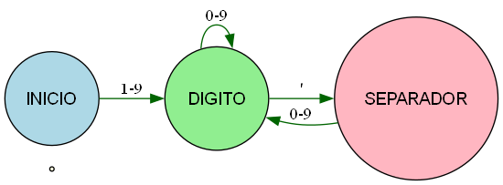
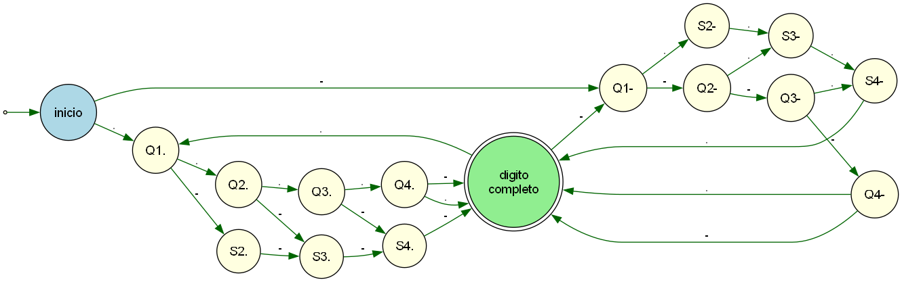

# Trabajo práctico 2: Sumadores

## Preliminar: Árboles de expresión

Siguiendo la sección 1.5.1 *Copia de archivos* de [KR1988], se analiza el
árbol de expresión de las siguientes dos expresiones:

**a)** `c = getchar() != EOF`

```Text
        =
       / \
      c   !=
         /  \
   getchar()  EOF
```

**b)** `c = (getchar() != EOF)`

```Text
          =
         / \
        c   !=
           /  \
         ()   EOF
         |  
 getchar()  
```

Aunque los árboles se representen de forma diferente, las dos expresiones son *semánticamente equivalentes*:

$$
c = \begin{cases}
1 & \text{si getchar() devuelve un valor distinto de EOF} \\
0 & \text{si getchar() devuelve EOF}
\end{cases}
$$

La diferencia está en la notación:

- En el primer caso, la precedencia ya impone el orden.
- En el segundo, los paréntesis lo hacen explícito.

## Decisiones de diseño

### Elección para SumarInt_Ns

Para el programa SumarInt_Ns, elegimos implementarlo para enteros de 64 bits. Para ello, se incluye `<stdint.h>` de la biblioteca estándar para utilizar el tipo de dato `int64_t`.

### Manejo de overflow

Se incluye `<limits.h>`, de la biblioteca estándar, para acceder a las constantes de límite de cada tipo (`INT_MAX`, `INT_MIN`, `INT64_MAX`), cuyos valores dependen de la plataforma de compilación.  
Los programas SumarBytes, SumarInts y SumarInt_Ns consideran únicamente entradas de números positivos, por lo que solo se contempla el overflow positivo. Antes de cada suma, se verifica que el resultado no exceda el límite superior del tipo: si `total > INT_MAX - n`, la suma desbordaría.  
El programa SumarDecimalesGetNextDecimal admite números con signo opcional (+, -, o sin signo), por lo que se contempla tanto el overflow positivo como el negativo:  

- Para overflow positivo: si `valor > INT_MAX / 10`, entonces `valor * 10` va a desbordar sin importar qué dígito venga después; si `valor == INT_MAX / 10` y `ValorDigito(c) > INT_MAX % 10`, entonces `valor * 10` no desborda por sí solo, pero puede desbordar dependiendo del dígito que se agregue.
- Para overflow negativo se aplica la misma lógica pero con `INT_MIN`. `INT_MAX % 10` e `INT_MIN % 10` devuelven el último dígito de cada límite, que representa el máximo dígito que se puede agregar sin desbordar en ese caso.
- Durante la suma acumulada: si `n > 0` se verifica que `total > INT_MAX - n`; si `n < 0` se verifica que `total < INT_MIN - n`. El chequeo según el signo de `n` es necesario para evitar que la resta en sí misma desborde antes de la comparación.
En todos los casos, el programa reporta el error en `stderr` y termina con código de salida `1`.
Esta verificación se realiza antes de la operación porque, en C, el overflow de enteros con signo es comportamiento indefinido.
  
### Separación de flujos: stdout y stderr
  
Los mensajes de error se emiten con `fprintf(stderr, ...)` en lugar de `printf(...)`. Esto permite mantener separados la salida normal del programa (`stdout`) y los mensajes de error (`stderr`), siguiendo la convención de que cada flujo tiene una responsabilidad distinta. De esta forma, el usuario puede redirigir la salida normal a un archivo sin mezclarla con los errores.  

### Análisis y aplicación de `goto` en la actualidad

El uso de `goto` mantiene vigencia en escenarios específicos de bajo nivel y optimización donde los mecanismos de control tradicionales resultan ineficientes.  
Casos de uso principales:

- **Limpieza de recursos y manejo de errores (Cleanup pattern):** Es su aplicación más frecuente en C. Al carecer de excepciones o bloques `finally`, si una función falla al reservar varios recursos (memoria, archivos), un `goto` permite saltar a una sección finalizada que libera todo en orden inverso. Esto evita duplicar código en cada `return` y previene fugas de memoria.
- **Máquinas de estados finitos (FSM):** Aplicado directamente en este trabajo para `GetNextX`. Etiquetar estados y saltar entre ellos con `goto` mapea las transiciones del autómata de forma directa y sin la sobrecarga de variables de control adicionales.
- **Despacho de bytecode (Computed GOTOs):** Intérpretes como CPython o Lua usan extensiones de C (`labels as values`) para despachar instrucciones rápidamente, superando el rendimiento de un `switch` convencional dentro de bucles críticos.

Presencia en lenguajes actuales:

- **C / C++:** Conservan la sentencia. Proyectos de gran escala como el Kernel de Linux, Git y FFmpeg la emplean de forma estándar para manejo de errores.
- **Go:** Incluye `goto` restringido a la misma función sin cruzar declaración de variables, útil para salir de bucles o simplificar la lógica.
- **C# y PHP:** Lo mantienen para saltos locales o dentro de estructuras `switch` complejas.
- **Rust, Java, Python y Swift:** No incluyen `goto` incondicional. Lo reemplazan con *labeled break/continue*, bloques `try/catch/finally` o tipos específicos de retorno (`Result`), respetando los principios de la programación estructurada.
  
## Referencias
  
- KR1988 — Secciones 2.2 y 7.2.
- ISO/IEC 9899:2024 (C23).
- [cppreference.com — `<stdint.h>`](https://en.cppreference.com/w/c/types/integer)
- [cppreference.com — `<limits.h>`](https://en.cppreference.com/w/c/types/limits)
- [cppreference.com — `fprintf`](https://en.cppreference.com/w/c/io/fprintf)
- [Graphviz — Lenguaje DOT](https://graphviz.org/doc/info/lang.html)
- [Linux Kernel Documentation — `goto`](https://www.kernel.org/doc/html/v4.10/process/coding-style.html)
- [GCC Official Docs — `goto`](https://gcc.gnu.org/onlinedocs/gcc/Labels-as-Values.html)

---

## Formalización del lenguaje formal Decimal-constant

El signo (`+`/`-`) no forma parte de la formalización: `GetNextDecimal` lo reconoce como un estado antes de delegar el reconocimiento del `digito-decimal`. Esta decisión surge ya que, en C23, las constantes no tienen signos. Lográn el negativo con la operación unario.  

### Por comprension

Sea `Σ = { '0', '1', '2', '3', '4', '5', '6', '7', '8', '9' }` y `S = { '\'' }` el separador. Definimos el conjunto de constantes decimales válidas:  

`D = { d · w : d ∈ Σ - {'0'}, w ∈ (Σ* · (S · Σ+)*)  }`  

Dónde:  
`d ∈ Σ - {'0'}` — el primer dígito es no nulo.  
`w ∈ Σ*` — cero o más dígitos sin restricción.  
`(S · Σ+)*` — cero o más grupos de separador seguido de uno o más dígitos.  
`·` denota concatenación.  

### Expresiones regulares

`(1+2+3+4+5+6+7+8+9) . ((0+1+2+3+4+5+6+7+8+9) + ' . (0+1+2+3+4+5+6+7+8+9))*`

### RegEx

`[1-9]('?[0-9])*`

### Gramaticas formales

```Text
G = {Vnt, Vt, P, S}
Vnt = {digito-decimal, digito-no-nulo, digito}
Vt = {', 0, 1, 2, 3, 4, 5, 6, 7, 8, 9} = Σ
S = digito-decimal
P = {
     digito-decimal --> digito-no-nulo,
     digito-decimal --> digito-decimal ' digito,
     digito-decimal --> digito-decimal digito,
     digito-no-nulo --> 1,
     digito-no-nulo --> 2,
     digito-no-nulo --> 3,
     digito-no-nulo --> 4,
     digito-no-nulo --> 5,
     digito-no-nulo --> 6,
     digito-no-nulo --> 7,
     digito-no-nulo --> 8,
     digito-no-nulo --> 9,
     digito --> 0,
     digito --> 1,
     digito --> 2,
     digito --> 3,
     digito --> 4,
     digito --> 5,
     digito --> 6,
     digito --> 7,
     digito --> 8,
     digito --> 9
}  
```

### BNF

```Text
digito-decimal:  
      digito-no-nulo  
      digito-decimal '(opt) digito  

digito-no-nulo:  
      1 2 3 4 5 6 7 8 9  

digito:  
      0 1 2 3 4 5 6 7 8 9
```

### Autómata finito

Ver `ConstanteDecimalC23.gv` con la extencion  Graphviz Interactive Preview



**Formalización como n-upla** `M = (Q, Σ, δ, q0, F)`:

- `Q = {INICIO, DIGITO, SEPARADOR}`
- `Σ = {', 0, 1, ..., 9}`
- `q0 = INICIO`
- `F = {DIGITO}`
- `δ`:

 ```Text
  δ(INICIO, d) = DIGITO   para todo d ∈ {1..9}   (digito-no-nulo)  
  δ(DIGITO, d) = DIGITO   para todo d ∈ {0..9}   (digito sin separador)
  δ(DIGITO, ') = SEPARADOR
  δ(SEPARADOR, d) = DIGITO   para todo d ∈ {0..9}   (digito tras separador)
 ```

---

## Formalización del lenguaje formal Morse

Un **numero-morse** es una secuencia de uno o más **digito-morse** escritos de forma continua, sin separador entre ellos. Los números se separan entre sí por uno o más caracteres de espacio (`' '`, `'\t'`, `'\r'`, `'\n'`) o por `EOF`.

Cada **digito-morse** son exactamente 5 símbolos de `{'.', '-'}`, organizados en dos "tramos": un primer tramo de `k` copias de un símbolo (1 ≤ k ≤ 5) seguido, si `k < 5`, de un segundo tramo de `5-k` copias del otro símbolo. Esta es exactamente la regla que implementa `GetNextX` a través de `primer_simbolo`, `cantidad_primer_tramo` y `en_segundo_tramo`, y reproduce los 10 códigos Morse reales de los dígitos 0-9.

Por ejemplo, `.----..---` representa el número `12` (dos dígitos pegados), mientras que `.---- ..---` representa dos números distintos (`1` y `2`) separados por un espacio.

### Por comprension (Morse)

Sea `Σ = {'.', '-'}`. Definimos el conjunto de **digito-morse** válidos:  

`M = { aᵏ b⁵⁻ᵏ : a, b ∈ Σ, a ≠ b, 1 ≤ k ≤ 5 }`

Dónde:
`b⁰` — es la cadena vacía, así que `k=5` da los casos "todo igual": `.....` y `-----`.
`|M| = 10` — uno por cada dígito 0-9.

Un **numero-morse** es una concatenación de uno o más dígitos Morse:

`N = M⁺`

### Expresiones regulares (Morse)

`(-----+.----+..---+...--+....-+.....+-....+--...+---..+----.) . (-----+.----+..---+...--+....-+.....+-....+--...+---..+----.)*`

### RegEx (Morse)

`[----- - ----.]([----- - ----.])*`

### Gramaticas formales (Morse)

```Text
- G = {Vnt, Vt, P, S}  
- Vnt = {numero-morse, digito-morse}  
- Vt = {'.', '-'}
- S = numero-morse
- P = {
      numero-morse --> digito-morse,
      numero-morse --> numero-morse digito-morse,
      digito-morse --> '-----',  
      digito-morse --> '.----',  
      digito-morse --> '..---',  
      digito-morse --> '...--',  
      digito-morse --> '....-',  
      digito-morse --> '.....',  
      digito-morse --> '-....',  
      digito-morse --> '--...',  
      digito-morse --> '---..',  
      digito-morse --> '----.'  
}
```

### BNF (Morse)

```Text
numero-morse:  
      digito-morse  
      numero-morse digito-morse  

digito-morse:
      ----- .---- ..--- ...-- ....- ..... -.... --... ---.. ----.
```

### Autómata finito (Morse)

Ver `ConstanteDecimalX.gv` con la extencion  Graphviz Interactive Preview.



Los nombres de los estados reflejan 1 a 1 las variables de `GetNextX`, con el agregado de un sufijo (`.` o `-`) que indica con qué símbolo arrancó el dígito
actual — necesario para que cada transición dependa únicamente del estado y el símbolo leído, y no de qué símbolo se leyó antes:

- `inicio`: equivalen a `total_simbolos == 0` (esperando el próximo dígito).
- `Qk.` / `Qk-`: `en_segundo_tramo == false`, `cantidad_primer_tramo == k`, habiendo arrancado el dígito con `.` o con `-` respectivamente.
- `Sk.` / `Sk-`: `en_segundo_tramo == true`, `total_simbolos == k`, habiendo arrancado el dígito con `.` o con `-` respectivamente.
- `digito_completo`: `total_simbolos == 5`, dígito completo.

**Formalización como n-upla** `M = (Q, Σ, δ, q0, F)`:

- `Q = {inicio, digito_completo, Q1., Q2., Q3., Q4., S2., S3., S4., Q1-, Q2-, Q3-, Q4-, S2-, S3-, S4-}`
- `Σ = {'.', '-'}`
- `q0 = inicio`
- `F = {digito_completo}`
- `δ`:

```Text
      δ(inicio, '.')  = Q1.               δ(inicio, '-')  = Q1-

      δ(Q1., '.')  = Q2.                  δ(Q1., '-')  = S2.
      δ(Q2., '.')  = Q3.                  δ(Q2., '-')  = S3.
      δ(Q3., '.')  = Q4.                  δ(Q3., '-')  = S4.
      δ(Q4., '.')  = digito_completo      δ(Q4., '-')  = digito_completo
      δ(S2., '-')  = S3.
      δ(S3., '-')  = S4.
      δ(S4., '-')  = digito_completo

      δ(Q1-, '-')  = Q2-                  δ(Q1-, '.')  = S2-
      δ(Q2-, '-')  = Q3-                  δ(Q2-, '.')  = S3-
      δ(Q3-, '-')  = Q4-                  δ(Q3-, '.')  = S4-
      δ(Q4-, '-')  = digito_completo      δ(Q4-, '.')  = digito_completo
      δ(S2-, '.')  = S3-
      δ(S3-, '.')  = S4-
      δ(S4-, '.')  = digito_completo

      δ(digito_completo, '.')  = Q1.    δ(digito_completo, '-')  = Q1-
```
